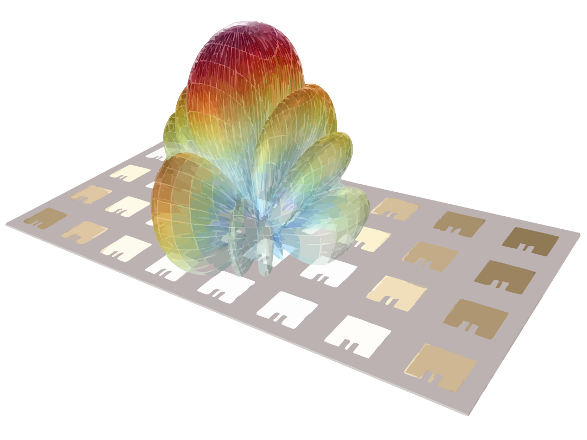
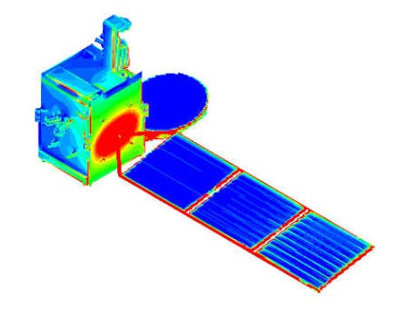
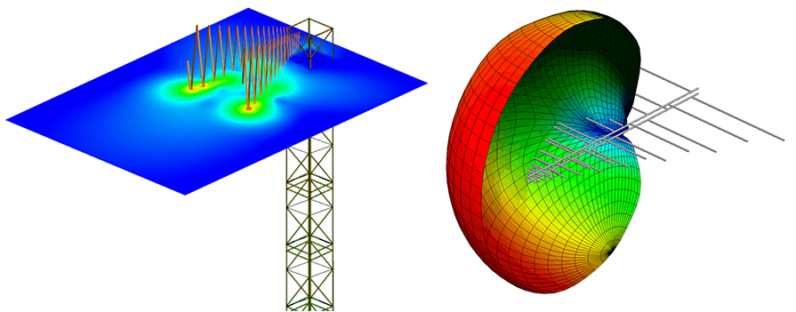
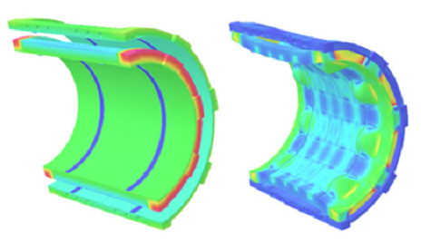
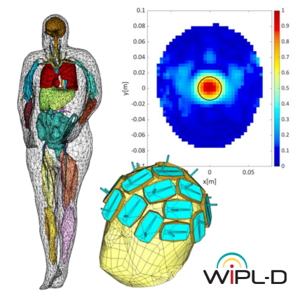
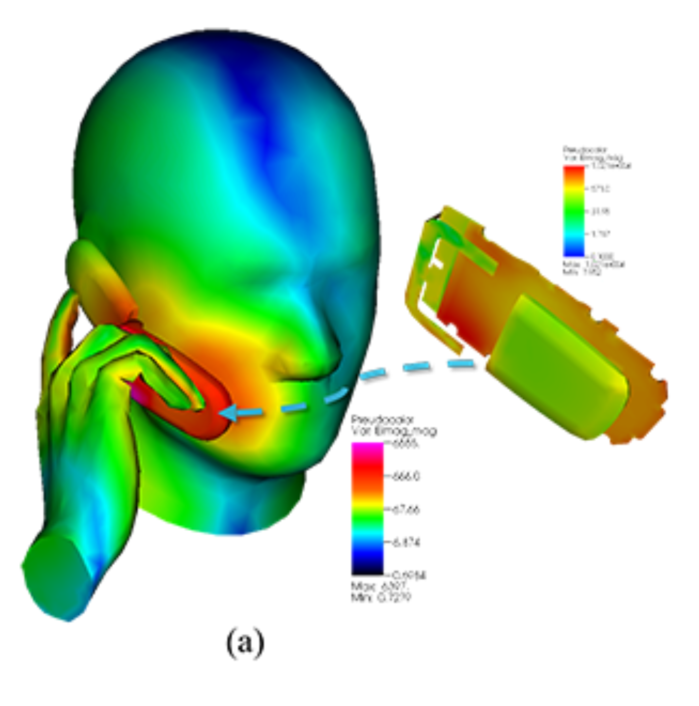
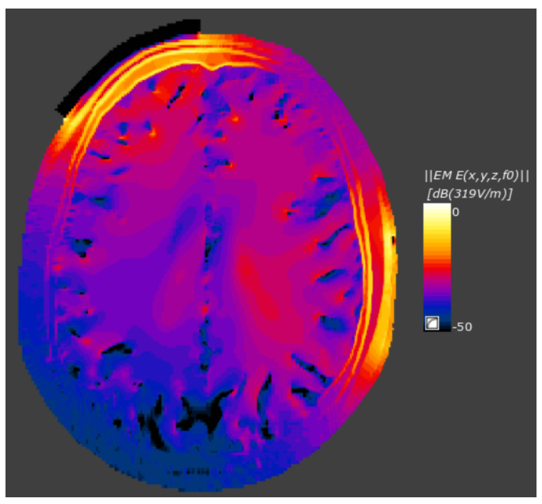
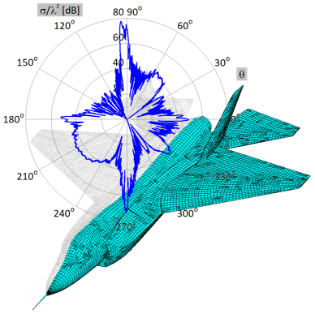
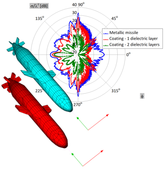
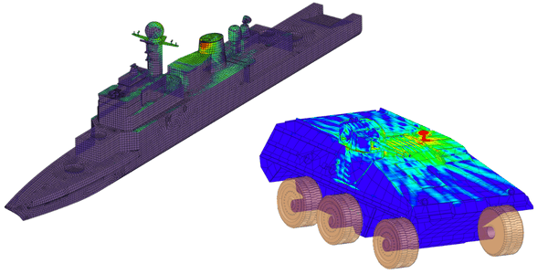

<h1>{{ page.title }}</h1>

Computational electromagnetism plays an essential role in the development of modern technology. Increasing performance demands lead to increasingly complex technologies, making it more difficult to accurately model the electromagnetic fields in state-of-the-art electronic devices and systems.

Efficient and flexible computational methods are therefore essential. Accurate electromagnetic simulations make technology development more efficient by reducing the need for costly and time–intensive prototyping, thereby lowering material waste, energy consumption, and development time. 

Below are some prominent application fields for computational electromagnetism, along with examples.

  

    <h3>Communication</h3>
    <ul>
      <li>Antennas (e.g. 6G)</li>
      <li>Microchips</li>
      <li>Mobile devices</li>
      <li>Wi-Fi coverage</li>
      <li>GPS/Satellite navigation</li>
    </ul>
  

  

    <figure>
      
      <figcaption>
        Microstrip antenna array <a href="https://www.trellisign.com/emag-solution">(Trellisign)</a>
      </figcaption>
    </figure>
    <figure>
      
      <figcaption>
        Satellite <a href="https://www.ema3d.com/blog/surface-to-surface-discharges-satellite-antenna-transients/">(EMA)</a>
      </figcaption>
    </figure>
    <figure>
      
      <figcaption>
        Antenna design <a href="https://help.altair.com/2021/feko/topics/feko/user_guide/introduction/antenna_design_feko_c.htm">(Altair Feko)</a>
      </figcaption>
    </figure>
  

  

    <h3>Medical</h3>
    <ul>
      <li>Device design (e.g. MRI)</li>
      <li>Imaging</li>
      <li>Exposure calculation</li>
      <li>Neurostimulation</li>
    </ul>
  

  

    <figure>
      
      <figcaption>
        EM fields in MRI <a href="https://plmtechtalk.com/2023/02/24/simulation-of-magnetic-fields-in-mri-machines/">(plm tech talk)</a>
      </figcaption>
    </figure>
    <figure>
      
      <figcaption>
        Design of a brain-imaging device <a href="https://wipl-d.com/applications/emc/">(WIPL-D)</a>
      </figcaption>
    </figure>
    <figure>
      
      <figcaption>
        Exposure calculation (SAR)
      </figcaption>
    </figure>
    <figure>
      
      <figcaption>
        Neurostimulation
      </figcaption>
    </figure>
  

  

    <h3>Military</h3>
    <ul>
      <li>Radar cross section (RCS)</li>
      <li>Communication systems</li>
    </ul>
  

  

    <figure>
      
      <figcaption>
        RCS of a fighter jet <a href="https://wipl-d.com/applications/rcs-scattering/">(WIPL-D)</a>
      </figcaption>
    </figure>
    <figure>
      
      <figcaption>
        RCS of a submarine <a href="https://wipl-d.com/applications/rcs-scattering/">(WIPL-D)</a>
      </figcaption>
    </figure>
    <figure>
      
      <figcaption>
        Electromagnetic scattering from military vehicles <a href="https://www.ticra.com/sectors/defence/">(ticra)</a>
      </figcaption>
    </figure>
  

